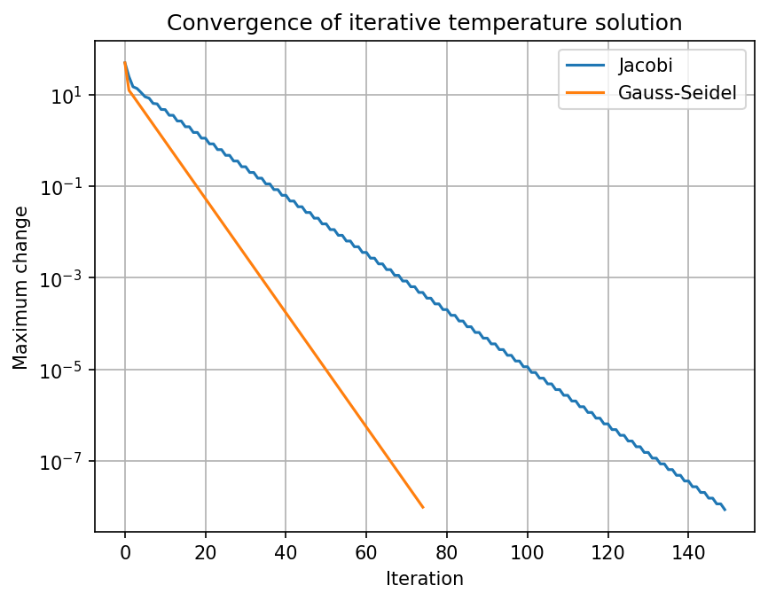
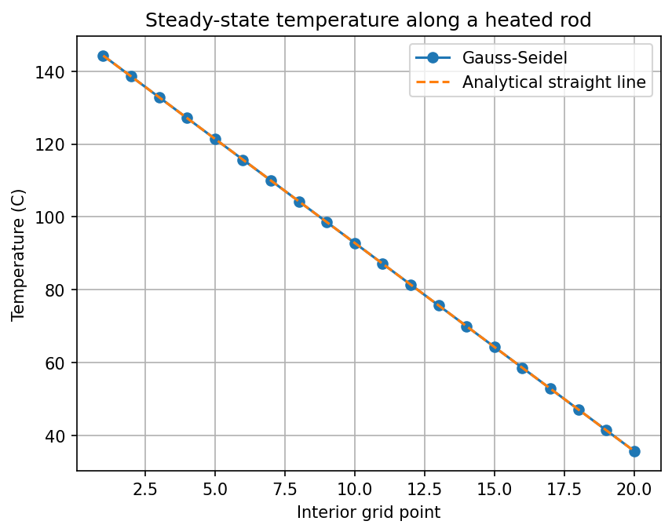

# Task 8: Iterative Methods for Linear Systems

**Concept:** Jacobi and Gauss-Seidel start from a guess and repeatedly improve it until the change between iterations drops below a tolerance. They are used when matrices are large and sparse.

**Files:** [`code/Task_08_iterative_linear.py`](../code/Task_08_iterative_linear.py) (given program) · [`code/Task_08_extension.py`](../code/Task_08_extension.py) (parameter change + new real-world case)

---

## 1. Inputs and mathematical operation

- **Input values:** a 5 × 5 tridiagonal matrix (diagonal 2, off-diagonals −1), right-hand side b = [100, 0, 0, 0, 20] (boundary temperatures 100 °C left and 20 °C right), tolerance 10⁻⁸, starting guess 0.
- **Mathematical operation:** repeated updates xᵢ = (bᵢ − Σⱼ≠ᵢ aᵢⱼxⱼ)/aᵢᵢ; Jacobi uses the old values, Gauss-Seidel uses the newest values.

## 2. Output of the program

```text
Jacobi temperatures: [86.66666665 73.33333331 59.99999997 46.66666664 33.33333332]
Gauss-Seidel temperatures: [86.66666665 73.3333333  59.99999997 46.66666665 33.33333332]
Direct solution: [86.66666667 73.33333333 60.         46.66666667 33.33333333]
Jacobi iterations: 150
Gauss-Seidel iterations: 75
```



## 3. Interpretation of the output

- The five interior points settle at about **86.7, 73.3, 60.0, 46.7, 33.3 °C**, a straight-line temperature drop from the hot end to the cold end, matching the direct solution to about 10⁻⁸.
- **Graph:** the vertical axis is logarithmic, so each curve is almost a straight line, meaning the error shrinks by a constant factor each iteration. Gauss-Seidel's line is steeper and ends at **75 iterations** compared with **150** for Jacobi: Gauss-Seidel converges about twice as fast because it reuses fresh values immediately.

## 4. Changing an input / parameter

**Change made:** boundary temperatures 100/20 → **80/30**, and the tolerance 10⁻⁸ → **10⁻⁴**.

```text
tol=1e-04: Jacobi 86 its, Gauss-Seidel 43 its, GS temps=[71.666 63.333 55.    46.666 38.333]
tol=1e-08: Jacobi 150 its, Gauss-Seidel 75 its, GS temps=[71.667 63.333 55.    46.667 38.333]
Direct solution: [71.667 63.333 55.    46.667 38.333]
```

**How the result changes:** A looser tolerance stops earlier (86 and 43 iterations vs 150 and 75) with answers accurate to about three decimals instead of eight. Changing the boundary temperatures only changes the final temperatures (now 71.7 → 38.3 °C); the iteration counts depend mainly on the matrix and the tolerance, not on the boundary values.

## 5. Modified program for a different but related real-world case

**Case:** Steady-state heat conduction along a metal rod with 20 interior points

**New assumptions**

- One-dimensional rod; the ends are held at 150 °C and 30 °C; no heat source; the system is in steady state.
- Each interior temperature is the average of its two neighbours, giving a 20 × 20 tridiagonal system.
- Tolerance 10⁻⁶.

**Input data:** `rod_system(20, 150, 30)` in `code/Task_08_extension.py`.

**Output**

```text
Jacobi iterations: 1299; Gauss-Seidel iterations: 655
Temperature at middle point (GS): 87.143 C
Max difference from direct solution: 4.39e-05
```



**Interpretation:** The larger system needs far more iterations (**1,299 Jacobi, 655 Gauss-Seidel**), so iterative methods slow down as the grid becomes finer, which motivates better methods in practice. The middle temperature is 87.14 °C, and the graph shows the computed points lying on the analytical straight line, confirming that the steady temperature changes linearly along a uniform rod.
